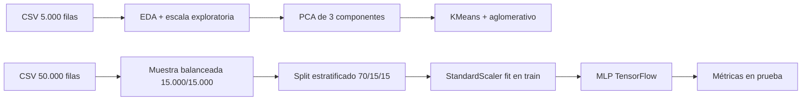

  <h1>VIH/SIDA: exploración y clasificación</h1>
  
<strong>De dos variantes de datos clínicos a una evaluación documentada de un clasificador binario.</strong> 
  Exploración de CD4/CD8, relaciones entre variables y una red neuronal sobre registros etiquetados.

  

    
    
    
    
    
    
    
    
  

  
<a href="VIH_SIDA.ipynb">Abrir el notebook</a> · <a href="#resultados">Ver resultados</a> · <a href="#evidencia">Revisar evidencia</a>

  

<em>Imagen de la presentación original; no constituye evidencia del análisis.</em>

**Proyecto académico en equipo · Data Mining · Universidad Externado de Colombia**

> **Nota de alcance:** este repositorio documenta un ejercicio académico de análisis exploratorio y clasificación. No es una herramienta de diagnóstico, no estima eficacia clínica de tratamientos y no sustituye validación médica o externa.

## En 30 segundos

<table align="center">
  <tr>
    <td align="center"><strong>50.000</strong> registros en la variante completa</td>
    <td align="center"><strong>23</strong> variables por registro</td>
    <td align="center"><strong>30.000</strong> pool balanceado (15.000/15.000)</td>
    <td align="center"><strong>0,6832</strong> ROC-AUC en prueba</td>
  </tr>
</table>

El notebook carga dos variantes del dataset —**5.000** y **50.000 registros**, ambas con **23 columnas**—. Para el clasificador se toma una muestra balanceada de 15.000 registros por clase, se separa de forma estratificada en entrenamiento, validación y prueba, y se conserva la salida histórica del conjunto de prueba de **4.500 filas**.

<a href="#pregunta">Pregunta</a> · <a href="#flujo">Flujo</a> · <a href="#resultados">Resultados</a> · <a href="#competencias">Competencias en equipo</a> · <a href="#evidencia">Evidencia</a> · <a href="#alcance">Alcance</a> · <a href="#creditos">Créditos</a>

## Pregunta y objetivo

El notebook plantea examinar cómo se relacionan el tipo de tratamiento y variables clínicas como **CD4**, **CD8**, edad, peso y antecedentes con la etiqueta `infected` en registros de adultos. La lectura de este README es deliberadamente exploratoria: describe patrones y capacidad de separación en una muestra balanceada, sin convertir asociaciones observadas en efectos causales ni en recomendaciones terapéuticas.

**Pregunta orientadora del proyecto:** ¿cómo se comportan los conteos CD4/CD8 frente a la monoterapia y la terapia combinada documentadas en el dataset, y qué tan separables resultan las etiquetas `infected` con las variables disponibles?

## Del dataset a la evaluación

| Etapa | Evidencia del notebook |
|---|---|
| **Explorar** | Estadística descriptiva, correlaciones Pearson/Spearman, pairplots y visualizaciones 3D con Plotly. |
| **Reducir y agrupar** | Estandarización, PCA de tres componentes, búsqueda de codo para KMeans y agrupamiento aglomerativo. |
| **Preparar** | Muestreo de 15.000 registros por clase, `StandardScaler` ajustado solo con entrenamiento y partición estratificada 70/15/15. |
| **Modelar** | Red densa 128→64→1, Dropout 0,3, Adam, entropía cruzada binaria, 20 épocas y lote 32. |

## Resultados guardados

Las siguientes cifras son las salidas conservadas en `VIH_SIDA.ipynb`; no se volvió a ejecutar el notebook para preparar esta documentación.

| Métrica en prueba | Salida | Contexto |
|---|---:|---|
| **Accuracy** | **0,64** | 4.500 filas de prueba balanceadas |
| **ROC-AUC** | **0,6832** | Probabilidades del clasificador; métrica independiente del umbral |
| **Recall, clase 0** | **0,59** | Reporte de clasificación guardado |
| **Recall, clase 1** | **0,68** | Reporte de clasificación guardado |

### Matriz de confusión

| Real \ Predicha | 0 | 1 |
|---|---:|---:|
| **0** | 1.335 | 915 |
| **1** | 723 | 1.527 |

El umbral 0,5 se usa únicamente para convertir probabilidades en etiquetas del reporte y la matriz de confusión. El resultado es una línea base académica: el ROC-AUC muestra separación moderada en esta partición, no una capacidad clínica generalizable.

## Competencias aplicadas en equipo

El notebook documenta un trabajo colectivo. Fabián participó en el proyecto; el reparto exacto de tareas no está detallado en la fuente. Esta sección resume competencias demostradas por la entrega, sin atribuir individualmente cada paso:

- Integración de la carga de los CSV y revisión de estructura, tipos y columnas.
- Exploración de variables clínicas y biomarcadores CD4/CD8 mediante correlaciones, gráficos, PCA y agrupamientos.
- Preparación del conjunto balanceado, partición estratificada, escalado y construcción del clasificador denso.
- Lectura de la evaluación guardada: reporte de clasificación, matriz de confusión, curvas de pérdida/precisión y ROC-AUC.

## Evidencia y materiales

| Recurso | Qué permite revisar |
|---|---|
| [Notebook principal](VIH_SIDA.ipynb) | 43 celdas con contexto, EDA, PCA, clustering, preparación, red neuronal y evaluación. |
| [Variante de 5.000 registros](AIDS_Classification_5000.csv) | Entrada utilizada en la exploración y visualizaciones detalladas. |
| [Variante de 50.000 registros](AIDS_Classification_50000.csv) | Entrada utilizada para el muestreo balanceado del clasificador. |
| [Presentación original en Canva](https://www.canva.com/design/DAGU5aj43Nw/0Crs18iyPqLgEDTiPIR95A/edit?utm_content=DAGU5aj43Nw&utm_campaign=designshare&utm_medium=link2&utm_source=sharebutton) | Contexto académico y narrativa original del equipo. |

## Alcance y lectura responsable

Detalles de datos, variables y evaluación

- La fuente citada es [AIDS Virus Infection Prediction](https://www.kaggle.com/datasets/aadarshvelu/aids-virus-infection-prediction/data), de Velu (2023). El README conserva la atribución original; no presenta el dataset como una cohorte clínica propia.
- `infected` es la etiqueta utilizada por el notebook. El campo `homo` aparece entre las 23 columnas y se usa como predictor; aquí se conserva su nombre original sin asignarle una interpretación textual adicional que el notebook no documenta.
- La muestra balanceada y la partición estratificada facilitan comparar las dos clases, pero cambian la prevalencia respecto de la variante completa. Por eso el accuracy y el ROC-AUC deben leerse junto con el contexto de la partición.
- El notebook declara metadata de Python 3.12.5. No se incluye un entorno bloqueado ni una validación externa; reproducirlo requiere ajustar las rutas de carga y revisar versiones de dependencias.

## Créditos

**Equipo de trabajo acreditado en el notebook:**

- **Edisson Fabian Tovar Castro**
- **Luisa Fernanda Arévalo Salinas**
- **Angélica Lorena Pinzón Rincón**

**Fuente de datos:** Velu, A. (2023). *AIDS virus infection prediction*. Kaggle. [Ficha y descarga](https://www.kaggle.com/datasets/aadarshvelu/aids-virus-infection-prediction/data).

[↑ Volver al inicio](#resumen)